# Manual de usuario — Sistema de Gestión Documental

El sistema guarda, organiza y comparte documentos de texto (`.txt`) y
Markdown (`.md`) en carpetas. Cada persona tiene su propio espacio, puede
compartir carpetas o archivos con sus compañeros, recuperar lo que eliminó
desde la papelera y consultar su historial.

Hay dos roles:

- **Usuario:** trabaja con sus documentos y con los que le compartieron.
- **Administrador:** puede hacer todo lo anterior. Además gestiona las cuentas,
  consulta los documentos de todos y ve los reportes y el historial globales.

Las capturas de pantalla están en `docs/SS/`.

---

## 1. Iniciar sesión

Abre `http://localhost:4200`, escribe tu nombre de usuario y tu contraseña, y
pulsa **Entrar**.

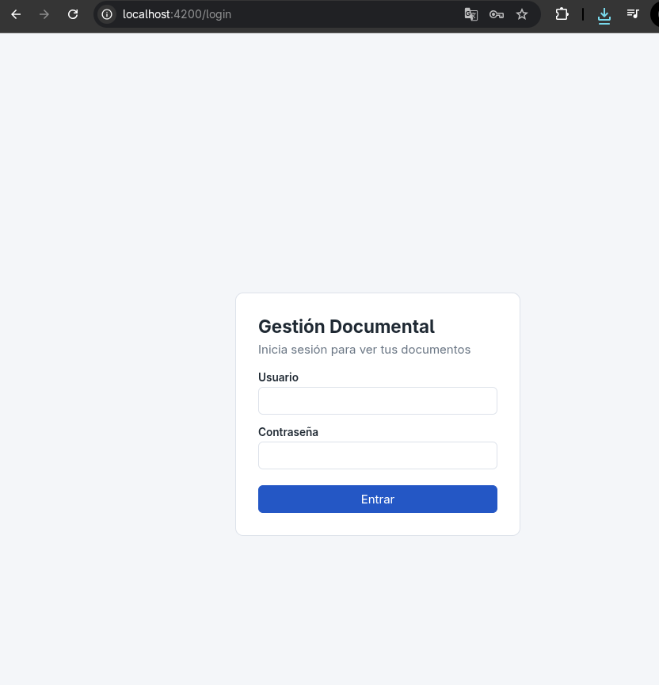

- Si los datos son incorrectos, aparece un mensaje y puedes intentarlo de
  nuevo. Los intentos fallidos quedan registrados en el historial.
- Si tu cuenta fue desactivada, no podrás entrar. Si la desactivan mientras
  la usas, la sesión se cierra en tu siguiente acción.
- La sesión dura 8 horas. Al vencer, el sistema te devuelve a esta pantalla.

Usuarios de prueba (contraseña `Documental2026!`): `admin` (administrador),
`mgarcia`, `jlopez` y `cperez` (usuarios).

## 2. La pantalla principal

A la izquierda está el menú, con tres grupos:

| Grupo | Opciones | Quién lo ve |
|---|---|---|
| Documentos | Mis documentos, Buscar, Compartido conmigo, Compartido por mí, Papelera | Todos |
| Consultas | Reportes, Mi actividad | Todos |
| Administración | Usuarios, Historial global | Solo el administrador |

Abajo del menú aparecen tu nombre, tu rol, el **espacio que usas** y el botón
**Cerrar sesión**. Los mensajes de confirmación y de error aparecen como un
aviso en una esquina de la pantalla.

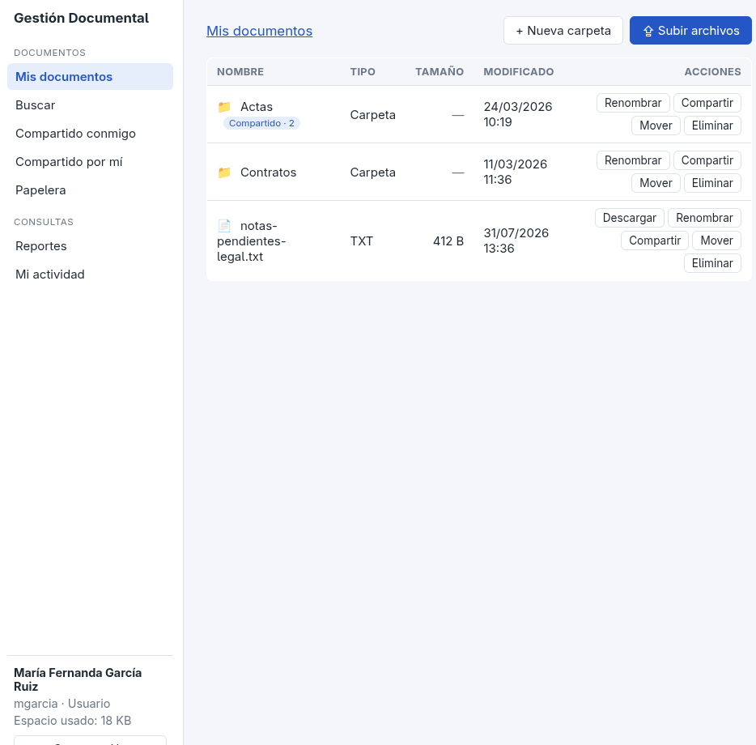

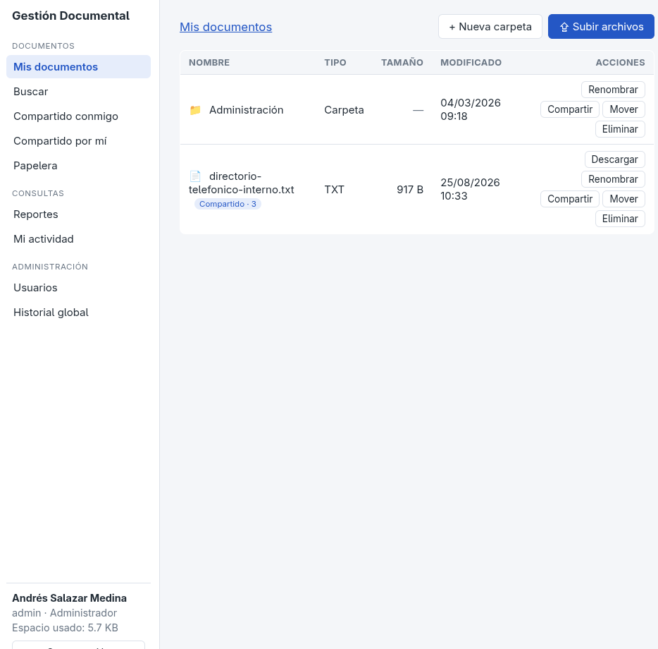

---

## 3. Pantallas para todos los usuarios

### 3.1 Mis documentos

Es el explorador de tus carpetas y archivos. Arriba están las **migas de pan**,
que muestran dónde estás (`Mis documentos / Proyectos / 2026`). Pulsa
cualquiera para volver a ese nivel, o usa **↑ Subir un nivel**.

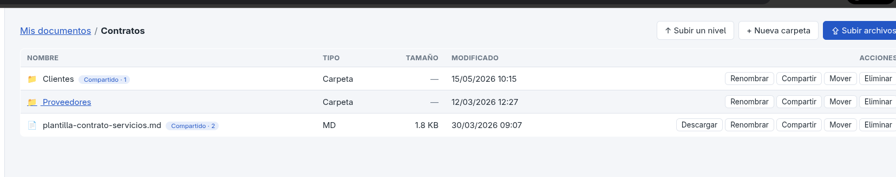

- **Abrir:** pulsa el nombre de una carpeta para entrar. Pulsa el nombre de un
  archivo para ver su **vista previa**: el Markdown se muestra con formato y el
  texto tal cual. Desde la vista previa también puedes descargarlo.
- **+ Nueva carpeta:** crea una carpeta dentro de la actual. No puede haber dos
  elementos con el mismo nombre en la misma carpeta.
- **⇪ Subir archivos:** elige uno o varios archivos `.txt` o `.md`, de hasta
  5 MB cada uno. También puedes **arrastrarlos** sobre la lista. Cada subida
  muestra su progreso; si alguna falla, por ejemplo por un nombre repetido o
  una extensión no permitida, se explica el motivo junto a ese archivo.
- Los elementos que compartiste muestran la etiqueta **Compartido · N**, con el
  número de personas.

Acciones de cada fila:

| Botón | Qué hace |
|---|---|
| Descargar | Baja el archivo a tu equipo (solo archivos) |
| Renombrar | Cambia el nombre. En un archivo se conserva la extensión |
| Compartir | Abre el diálogo de permisos (ver 3.4) |
| Mover | Elige otra carpeta destino, o la raíz. Una carpeta no se puede mover dentro de sí misma ni de una de sus subcarpetas |
| Eliminar | Manda el elemento a la papelera, previa confirmación. Una carpeta se va con todo su contenido |

#### Carpetas que te compartieron

Si entras a una carpeta de otra persona desde **Compartido conmigo**, un aviso
indica tu nivel de permiso y solo aparecen los botones que ese nivel permite:

| Nivel | Puedes |
|---|---|
| Lectura | Navegar, ver la vista previa y descargar |
| Comentario | Lo mismo que Lectura |
| Edición | Además, renombrar |

Crear, subir, mover, eliminar y compartir quedan para el propietario. Compartir
una carpeta da acceso a **todo su contenido**, incluidas las subcarpetas y lo
que se agregue después. Si te llega el mismo archivo por dos caminos, por
ejemplo con Lectura por la carpeta y Edición directa, vale el nivel más alto.

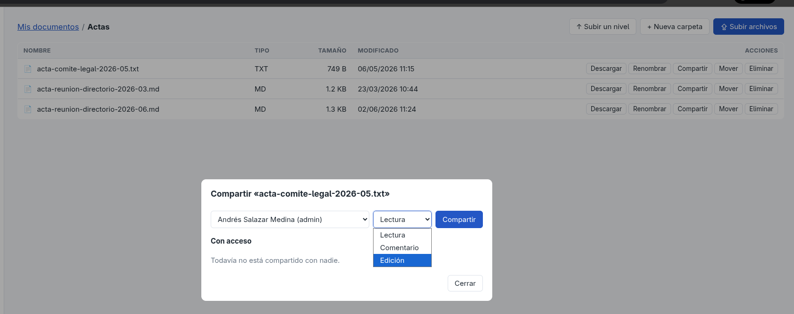

### 3.2 Buscar

Busca archivos entre los tuyos y los que te compartieron. Los filtros se
pueden combinar:

- **Texto (nombre o etiquetas):** palabras completas. «contrato» también
  encuentra «contratos».
- **Tipo:** `.txt` o `.md`.
- **Subido desde / hasta:** un rango de fechas.
- **Carpeta**, y si se marca **Incluir subcarpetas**, busca también en todo lo
  que hay dentro de ella.

Los resultados muestran la ubicación de cada archivo, si es de otro usuario, y
los botones de vista previa y descarga. Se muestran por páginas.

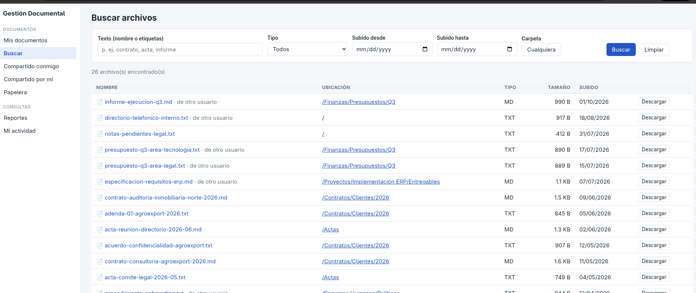

### 3.3 Compartido conmigo / Compartido por mí

- **Compartido conmigo:** lo que otras personas te compartieron directamente,
  con su propietario, **tu nivel** y la fecha en que lo recibiste. Una carpeta
  se abre en el explorador; un archivo, en su vista previa.
- **Compartido por mí:** tus carpetas y archivos compartidos, con quién y con
  qué nivel. **Gestionar** abre el mismo diálogo de permisos.

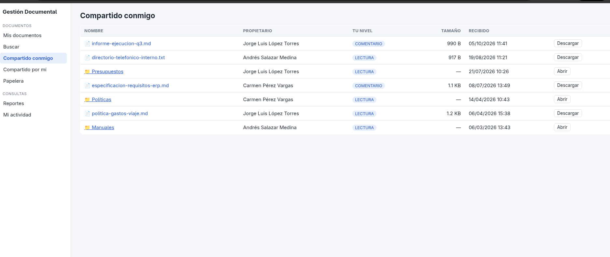

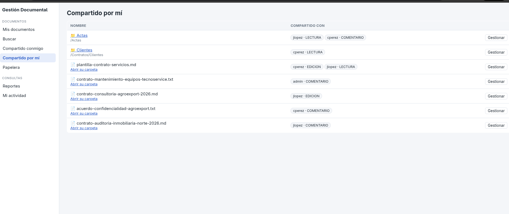

### 3.4 Compartir un recurso

En **Mis documentos**, pulsa **Compartir** en una carpeta o un archivo:

1. Elige a la persona y el nivel (Lectura, Comentario o Edición), y pulsa
   **Compartir**.
2. En la lista de abajo puedes **cambiar el nivel** de quien ya tiene acceso o
   **quitarle el acceso**.

Si compartes una carpeta, el diálogo te recuerda que la otra persona verá todo
su contenido. Todos los cambios quedan en el historial.

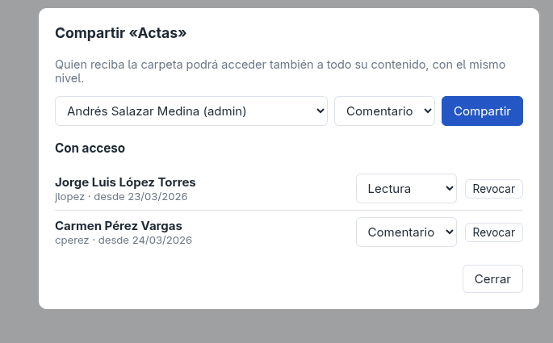

### 3.5 Papelera

Lo que eliminas no se borra: queda aquí con su **ubicación original** y la
fecha en que lo eliminaste.

- **Restaurar** lo devuelve a su carpeta. Si esa carpeta ya no existe o
  también está en la papelera, vuelve a la raíz de Mis documentos y un aviso te
  lo explica. Si mientras tanto alguien ocupó su nombre, se restaura con un
  número, por ejemplo `informe (2).md`.
- Una carpeta restaurada vuelve con el contenido que se eliminó junto con ella.
- **Eliminar definitivamente** lo borra para siempre, previa confirmación, y
  libera el espacio que ocupaba.

Los elementos en la papelera **siguen ocupando espacio** hasta que los eliminas
definitivamente.

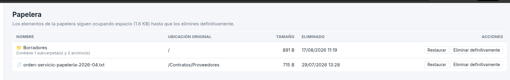

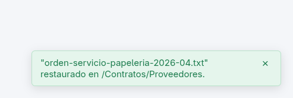

### 3.6 Mi actividad

Tu historial: cada inicio de sesión, subida, descarga, cambio de nombre,
movimiento, eliminación, restauración y permiso compartido o retirado, con su
fecha y detalle. Se puede filtrar por **acción**, **tipo de recurso** y
**rango de fechas**. Muestra 25 entradas por página.

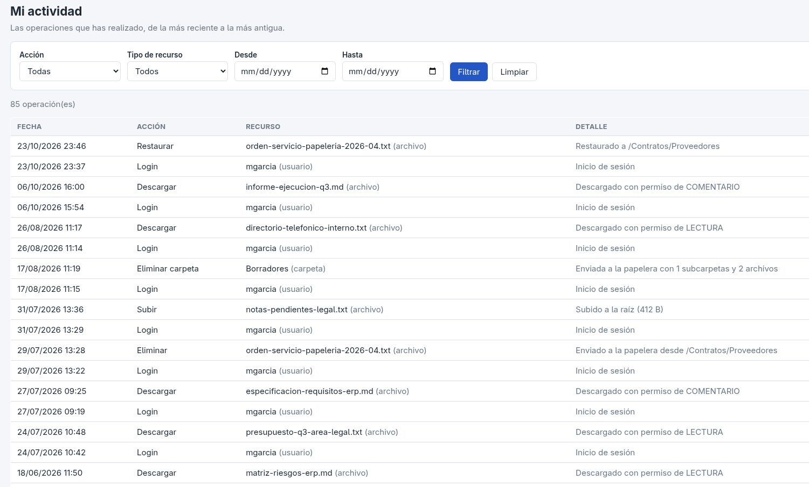

### 3.7 Reportes

La pantalla de reportes muestra una tarjeta por cada reporte disponible. Cada
uno tiene sus filtros y su tabla de resultados. Un usuario normal ve estos
cuatro, siempre sobre sus propios datos:

| # | Reporte |
|:-:|---|
| 6 | Recursos compartidos con más usuarios |
| 7 | Recursos compartidos por un usuario |
| 8 | Recursos recibidos por un usuario |
| 9 | Historial de un usuario por fechas |

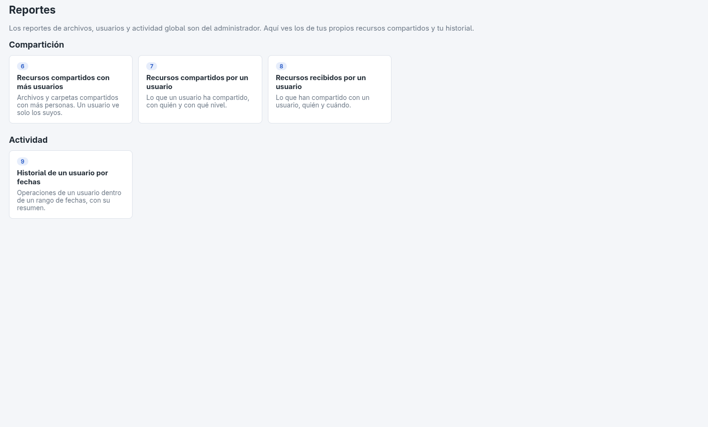

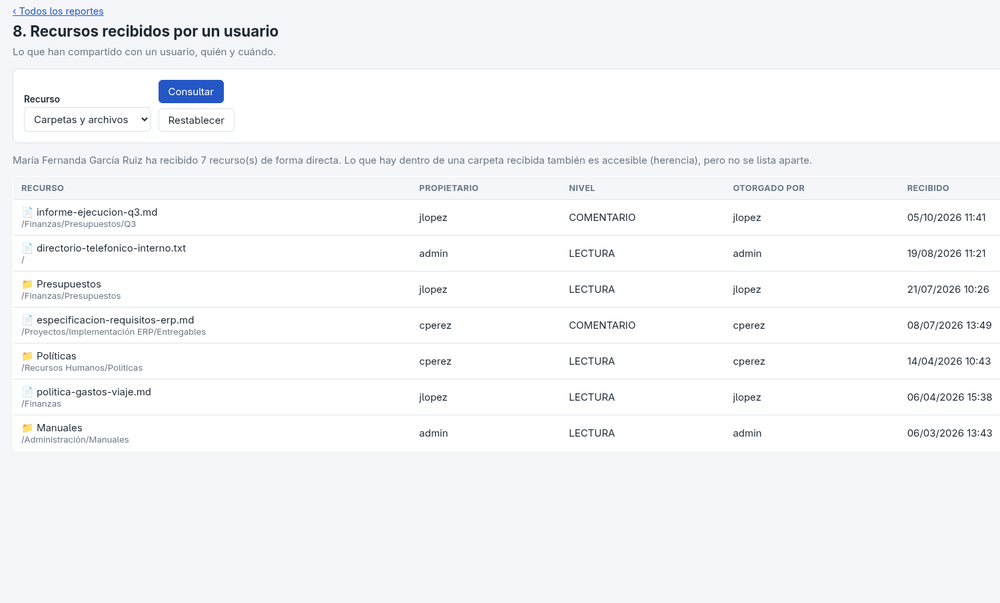

---

## 4. Pantallas del administrador

El administrador ve todo lo de la sección 3 y además lo siguiente.

### 4.1 Documentos de todos

En **Buscar**, el administrador encuentra archivos de **todos los usuarios**.
Los que no son suyos se marcan como «de otro usuario». Puede consultarlos y
descargarlos, pero no moverlos, eliminarlos ni cambiarles el nombre: eso le
corresponde a su propietario.

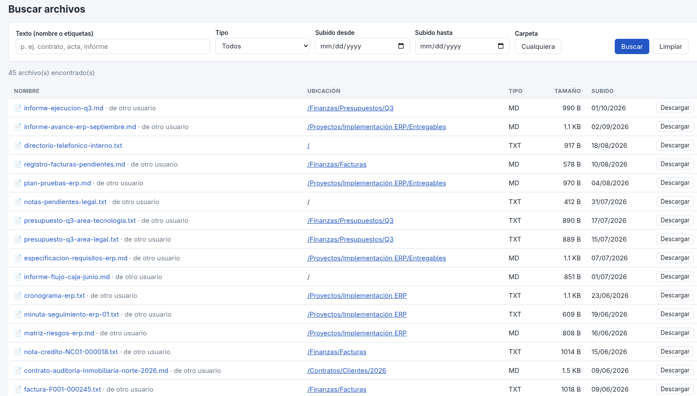

### 4.2 Usuarios

Lista todas las cuentas con su correo, rol, estado, espacio usado y fecha de
creación, y se puede filtrar por **rol** y por **estado**.

- **+ Nuevo usuario:** nombre de usuario (de 3 a 30 caracteres: minúsculas,
  números, punto, guion o guion bajo), nombre completo, correo, rol y una
  contraseña de al menos 8 caracteres. El nombre de usuario y el correo deben
  ser únicos.
- **Editar:** cambia el nombre, el correo, el rol o la contraseña. Si dejas la
  contraseña vacía, no se cambia. El nombre de usuario no se puede cambiar.
- **Desactivar** (previa confirmación) impide que esa persona inicie sesión,
  pero **no borra nada**: sus documentos, permisos e historial se conservan y la
  cuenta se puede volver a **Activar**.
- Por seguridad, el administrador no puede desactivarse ni quitarse el rol a sí
  mismo.

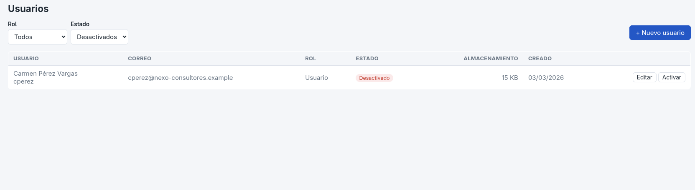

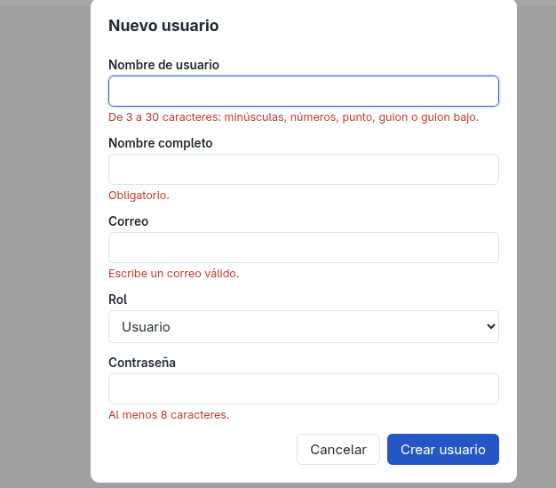

### 4.3 Historial global

El historial de todos los usuarios, con una columna y un filtro adicionales
por **usuario**. Pulsa el nombre de una persona para ver solo su actividad.
Los inicios de sesión fallidos se resaltan en rojo.

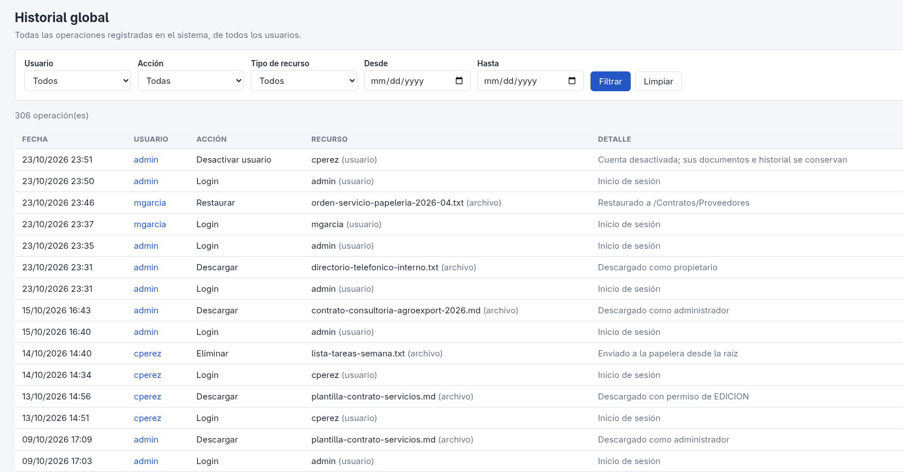

### 4.4 Todos los reportes

El administrador ve los doce reportes, sobre los datos de todo el sistema:

| Grupo | # | Reporte |
|---|:-:|---|
| Archivos y almacenamiento | 1 | Archivos por tipo |
| | 2 | Archivos por rango de fechas |
| | 3 | Archivos con más operaciones |
| Usuarios | 4 | Top usuarios por archivos |
| | 5 | Usuarios que más comparten |
| Compartición | 6 | Recursos compartidos con más usuarios |
| | 7 | Recursos compartidos por un usuario |
| | 8 | Recursos recibidos por un usuario |
| Actividad | 9 | Historial de un usuario por fechas |
| | 10 | Operaciones por tipo |
| | 11 | Operaciones por período (día, semana, mes o año) |
| | 12 | Principales acciones |

En los reportes 7, 8 y 9 el administrador elige de qué usuario consultar.

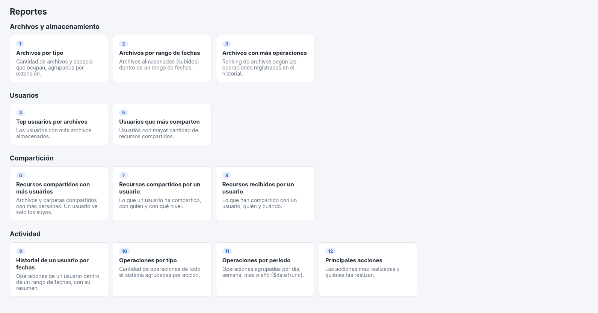

