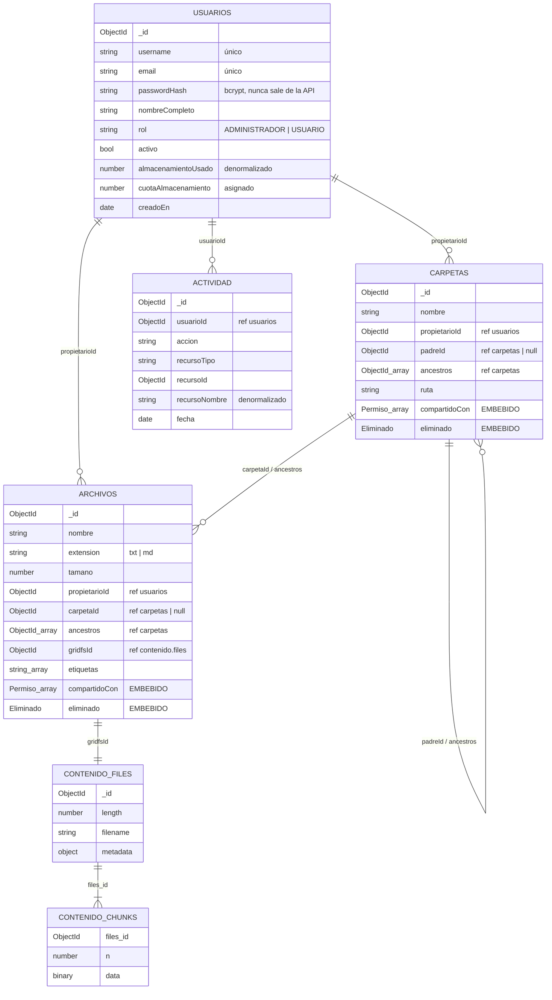

# Modelo documental — Sistema de Gestión Documental

Base de datos MongoDB `gestion_documental`. Este documento describe las
colecciones, **por qué cada dato va embebido o referenciado**, el patrón de
árbol elegido, el almacenamiento del contenido en GridFS y los índices.

Los esquemas viven en `backend/src/modelos/` (Mongoose) y GridFS en
`backend/src/config/gridfs.js`. Cada decisión también está comentada en el
código, junto al campo que la implementa.

---

## 1. Colecciones

| Colección | Qué guarda | Documentos en la carga inicial |
|---|---|:-:|
| `usuarios` | Cuentas, rol y espacio usado | 4 |
| `carpetas` | Jerarquía de carpetas, con permisos y estado de papelera embebidos | 18 |
| `archivos` | Metadatos de cada archivo, con permisos y estado de papelera embebidos | 50 |
| `actividad` | Historial de operaciones (auditoría) | ~300 |
| `contenido.files` / `contenido.chunks` | Contenido de los archivos (GridFS, bucket `contenido`) | 50 / 50 |

### 1.1 `usuarios`

| Campo | Tipo | Notas |
|---|---|---|
| `_id` | ObjectId | |
| `username` | String | Único, en minúsculas, 3–30 caracteres `[a-z0-9._-]`. No se puede modificar |
| `email` | String | Único, en minúsculas |
| `passwordHash` | String | Hash bcrypt (costo 10). `select: false` y eliminado en `toJSON`: **nunca sale en una respuesta de la API** |
| `nombreCompleto` | String | Máximo 100 caracteres |
| `rol` | String | `ADMINISTRADOR` \| `USUARIO` |
| `activo` | Boolean | Desactivar no borra nada; solo impide iniciar sesión |
| `almacenamientoUsado` | Number | Bytes. **Denormalizado** (Computed Pattern, ver §2) |
| `cuotaAlmacenamiento` | Number | Bytes **asignados**; los fija el administrador (20 MB por defecto, máximo 10 GB). Una subida que no cabe se rechaza |
| *(virtual)* `almacenamientoDisponible` | Number | `cuota − usado`. **No se guarda**: se calcula al serializar |
| `creadoEn` | Date | |

### 1.2 `carpetas`

| Campo | Tipo | Notas |
|---|---|---|
| `_id` | ObjectId | |
| `nombre` | String | Sin `/` ni `\`; único entre hermanos (validado en el servicio) |
| `propietarioId` | ObjectId → `usuarios` | **Referencia** |
| `padreId` | ObjectId → `carpetas` \| null | `null` = carpeta en la raíz del usuario |
| `ancestros` | [ObjectId → `carpetas`] | De la raíz al padre directo. Patrón **Array of Ancestors** (§3) |
| `ruta` | String | `"/Contratos/Clientes/2026"`: ubicación legible sin leer cada ancestro |
| `compartidoCon` | [Permiso] | **Embebido** (ver subdocumento abajo) |
| `eliminado` | Eliminado | **Embebido** (ver subdocumento abajo) |
| `creadoEn`, `actualizadoEn` | Date | |

### 1.3 `archivos`

| Campo | Tipo | Notas |
|---|---|---|
| `_id` | ObjectId | |
| `nombre` | String | Con extensión, que debe coincidir con `extension` |
| `extension` | String | `txt` \| `md` (solo esos dos tipos) |
| `mimeType` | String | `text/plain` \| `text/markdown` |
| `tamano` | Number | Bytes. Coincide con `length` en `contenido.files` |
| `propietarioId` | ObjectId → `usuarios` | **Referencia** |
| `carpetaId` | ObjectId → `carpetas` \| null | Carpeta directa; `null` = raíz |
| `ancestros` | [ObjectId → `carpetas`] | Todas las carpetas que lo contienen, **incluida la directa** |
| `gridfsId` | ObjectId → `contenido.files` | **Referencia** al contenido (§4) |
| `etiquetas` | [String] | En minúsculas; entran en la búsqueda por texto |
| `compartidoCon` | [Permiso] | **Embebido** |
| `eliminado` | Eliminado | **Embebido** |
| `creadoEn`, `actualizadoEn` | Date | |

### 1.4 Subdocumentos comunes (`modelos/esquemasComunes.js`)

Se definen una sola vez y los usan `carpetas` y `archivos`, para que las reglas
sean idénticas en ambas colecciones.

**Permiso** (elementos de `compartidoCon`, sin `_id` propio):

| Campo | Tipo | Notas |
|---|---|---|
| `usuarioId` | ObjectId → `usuarios` | A quién se compartió |
| `nivel` | String | `LECTURA` < `COMENTARIO` < `EDICION` |
| `otorgadoPor` | ObjectId → `usuarios` | Quién lo compartió |
| `otorgadoEn` | Date | |

**Eliminado** (relación uno a uno con el recurso):

| Campo | Tipo | Notas |
|---|---|---|
| `estado` | Boolean | `false` por defecto. Todo listado filtra `{"eliminado.estado": false}` |
| `fecha` | Date \| null | Cuándo se envió a la papelera |
| `eliminadoPor` | ObjectId → `usuarios` \| null | |
| `padreOriginalId` | ObjectId → `carpetas` \| null | A dónde restaurarlo |

### 1.5 `actividad`

| Campo | Tipo | Notas |
|---|---|---|
| `_id` | ObjectId | |
| `usuarioId` | ObjectId → `usuarios` | **Referencia**. Solo falta en un `LOGIN_FALLIDO` de un username inexistente |
| `accion` | String | `LOGIN`, `LOGIN_FALLIDO`, `CREAR_USUARIO`, `MODIFICAR_USUARIO`, `ACTIVAR_USUARIO`, `DESACTIVAR_USUARIO`, `CREAR_CARPETA`, `ELIMINAR_CARPETA`, `SUBIR`, `DESCARGAR`, `RENOMBRAR`, `MOVER`, `ELIMINAR`, `RESTAURAR`, `ELIMINAR_DEFINITIVO`, `COMPARTIR`, `MODIFICAR_PERMISO`, `REVOCAR` |
| `recursoTipo` | String | `ARCHIVO` \| `CARPETA` \| `USUARIO` |
| `recursoId` | ObjectId | Puede apuntar a un recurso que ya no existe |
| `recursoNombre` | String | **Denormalizado**: el nombre en el momento de la operación |
| `detalle` | String | Texto libre ("Liberados 972 B", "rol USUARIO → ADMINISTRADOR") |
| `fecha` | Date | Las entradas solo se insertan, nunca se modifican |

### 1.6 Ejemplos reales (de la carga inicial)

Un archivo compartido con dos usuarios. Los permisos y el estado de papelera
viajan dentro del propio documento:

```js
{
  _id: ObjectId('6adbc6bb674ef5ea12fd56d6'),
  nombre: 'plantilla-contrato-servicios.md',
  extension: 'md',
  mimeType: 'text/markdown',
  tamano: 1816,
  propietarioId: ObjectId('6adbc6bb674ef5ea12fd56c6'),   // mgarcia
  carpetaId: ObjectId('6adbc6bb674ef5ea12fd56d1'),       // /Contratos
  ancestros: [ ObjectId('6adbc6bb674ef5ea12fd56d1') ],
  gridfsId: ObjectId('6adbc6bb674ef5ea12fd56d4'),        // contenido.files
  etiquetas: [ 'plantilla', 'contrato' ],
  compartidoCon: [
    { usuarioId: ObjectId('…56c8'), nivel: 'EDICION', otorgadoPor: ObjectId('…56c6'), otorgadoEn: ISODate('2026-03-27T16:10:00Z') },
    { usuarioId: ObjectId('…56c7'), nivel: 'LECTURA', otorgadoPor: ObjectId('…56c6'), otorgadoEn: ISODate('2026-03-30T15:07:00Z') }
  ],
  eliminado: { estado: false, fecha: null, eliminadoPor: null, padreOriginalId: null },
  creadoEn: ISODate('2026-03-13T21:16:00Z'),
  actualizadoEn: ISODate('2026-03-30T15:07:00Z')
}
```

Una carpeta de tercer nivel. `ancestros` lista `/Contratos` y `/Contratos/Clientes`:

```js
{
  _id: ObjectId('6adbc6bb674ef5ea12fd5724'),
  nombre: '2026',
  propietarioId: ObjectId('6adbc6bb674ef5ea12fd56c6'),
  padreId: ObjectId('6adbc6bb674ef5ea12fd56d2'),
  ancestros: [ ObjectId('6adbc6bb674ef5ea12fd56d1'), ObjectId('6adbc6bb674ef5ea12fd56d2') ],
  ruta: '/Contratos/Clientes/2026',
  compartidoCon: [],
  eliminado: { estado: false, fecha: null, eliminadoPor: null, padreOriginalId: null }
}
```

Una entrada de historial cuyo archivo ya se eliminó definitivamente. El nombre
sigue legible porque está copiado en `recursoNombre`:

```js
{
  usuarioId: ObjectId('6adbc6bb674ef5ea12fd56c7'),
  accion: 'ELIMINAR_DEFINITIVO',
  recursoTipo: 'ARCHIVO',
  recursoId: ObjectId('6adbc6bb674ef5ea12fd570c'),   // ya no existe en `archivos`
  recursoNombre: 'factura-F001-000231-duplicado.txt',
  detalle: 'Liberados 972 B',
  fecha: ISODate('2026-05-04T15:46:00Z')
}
```

---

## 2. Embebido o referencia: la justificación de cada decisión

| Dato | Decisión | Por qué |
|---|---|---|
| Permisos (`compartidoCon`) | **Embebido** | Se leen siempre junto al recurso y son pocos por recurso. La pregunta real es "¿este usuario puede ver este archivo?", y con el documento en mano se responde sin una segunda consulta |
| Estado de papelera (`eliminado`) | **Embebido** | Relación uno a uno con el recurso; nunca se consulta por separado |
| Contenido del archivo | **GridFS** | Es el mecanismo que MongoDB provee para archivos. Separa los metadatos —consultados en cada listado— del contenido, que solo se lee al descargar. Además evita el límite de 16 MB del documento BSON |
| Historial (`actividad`) | **Colección aparte** | Crece sin límite. Embeberlo en el usuario chocaría contra el límite de 16 MB del documento: es el caso de libro para usar referencias |
| Jerarquía de carpetas | **`padreId` + `ancestros`** | El array de ancestros permite traer todo un subárbol con una sola consulta indexada, necesario para mover carpetas y para la papelera en cascada |
| Propietario | **Referencia** | El usuario cambia de forma independiente del recurso; duplicar su nombre obligaría a actualizarlo en miles de documentos |
| `recursoNombre` en actividad | **Denormalizado** | Si el recurso se elimina definitivamente, el historial debe seguir siendo legible |
| `almacenamientoUsado` | **Denormalizado** | Calcularlo con una agregación en cada consulta sería costoso. Se actualiza en cada subida y eliminación (*Computed Pattern*) |
| Espacio disponible | **Calculado, no guardado** | Es `cuotaAlmacenamiento − almacenamientoUsado`. Guardarlo sería un segundo dato denormalizado que mantener sincronizado; restar dos campos del mismo documento no cuesta nada |

### Matices que conviene conocer

- **Por qué `compartidoCon` no es una colección `permisos`.** Con una colección
  aparte, abrir un archivo costaría dos consultas: el archivo y sus permisos.
  Embebido, el mismo documento ya trae la respuesta. "Compartido conmigo"
  sigue siendo una consulta indexada gracias al índice multiclave
  `{"compartidoCon.usuarioId": 1}`. Embeber sería un error si un recurso se
  compartiera con miles de usuarios, porque el array crecería sin control.
  Ese no es el uso de un gestor documental de una organización.
- **Por qué el permiso guarda `usuarioId` y no el nombre del destinatario.**
  Por la misma razón que el propietario: el nombre cambia. Las pantallas lo
  resuelven con `$lookup` o `populate` solo sobre las filas que se muestran.
- **Por qué la herencia de permisos no se copia a cada archivo.** Compartir
  una carpeta da acceso a todo su contenido a cualquier profundidad, incluido
  lo que se agregue después. Copiar el permiso a cada descendiente obligaría a
  mantener esas copias al subir, mover o revocar. En lugar de eso, se consulta
  si alguna carpeta de `archivo.ancestros` está compartida con el usuario:
  una sola consulta por `_id` (`servicios/permisos.js`). Si el usuario llega
  por dos vías, gana el nivel más alto.
- **Cómo se respeta la cuota con subidas simultáneas.** Antes de escribir en
  GridFS, la subida *reserva* los bytes con un solo `updateOne` condicionado:
  `{_id, $expr: {$lte: [{$add: ["$almacenamientoUsado", bytes]}, "$cuotaAlmacenamiento"]}}`
  con `$inc`. Comprobar y sumar es una operación atómica sobre el documento
  del usuario, así que dos subidas a la vez no pueden pasarse de la cuota
  (con "leer, comparar y luego sumar", las dos verían espacio libre). Si
  después falla GridFS o el insert, la reserva se devuelve.
- **Por qué `almacenamientoUsado` no baja al enviar a la papelera.** El
  archivo sigue guardado y se puede restaurar, así que sigue ocupando espacio.
  Solo la eliminación definitiva lo descuenta, en la misma operación que borra
  el contenido de GridFS. La verificación de la carga inicial
  (`npm run seed:verificar`) comprueba que este campo sea igual a la suma real
  de `tamano`.
- **Por qué `ruta` coexiste con `ancestros`.** `ancestros` sirve para consultar
  (ids indexados); `ruta` sirve para mostrar ("/Contratos/Clientes") sin leer
  el nombre de cada ancestro. Ambos se recalculan juntos al mover o renombrar.

---

## 3. El patrón Array of Ancestors

Cada carpeta guarda su padre directo (`padreId`) **y** la lista completa de sus
ancestros, de la raíz hacia abajo (`ancestros`). Cada archivo guarda las
carpetas que lo contienen, incluida la directa.

```
/Contratos                 ancestros: []
└── /Contratos/Clientes    ancestros: [Contratos]
    └── 2026               ancestros: [Contratos, Clientes]
        └── acta.md        ancestros: [Contratos, Clientes, 2026]   (archivo)
```

### Qué resuelve

```js
// 1. Todo el subárbol de una carpeta: UNA consulta indexada, sin recursión
db.carpetas.find({ ancestros: carpetaId })
db.archivos.find({ ancestros: carpetaId })

// 2. La miga de pan: los ancestros ya están en el documento
carpeta.ancestros

// 3. Detectar ciclos al mover A dentro de B
if (B._id.equals(A._id) || B.ancestros.some((id) => id.equals(A._id))) rechazar()

// 4. Permisos heredados: las carpetas de las que puede heredar ya están listadas
db.carpetas.find({ _id: { $in: archivo.ancestros }, 'compartidoCon.usuarioId': usuarioId })
```

Lo usan:

- enviar una carpeta a la papelera en cascada, junto con todo su subárbol;
- eliminarla definitivamente;
- mover;
- la búsqueda "dentro de esta carpeta y sus subcarpetas";
- la verificación de permisos heredados.

### Qué cuesta

Al **mover** una carpeta hay que recalcular `ancestros` y `ruta` de todo su
subárbol, carpetas y archivos (`servicios/arbol.js`). Al **renombrarla**, se
recalcula la `ruta` de sus descendientes. Es el precio del patrón, y se
acepta porque mover es una operación rara y listar es constante.

### Alternativas descartadas

- **Solo `padreId` (Parent References).** Obtener un subárbol obligaría a
  recorrer el árbol nivel por nivel, con una consulta por nivel o un
  `$graphLookup` en cada operación.
- **Materialized Paths (solo `ruta`).** Las consultas serían por prefijo de
  texto (`/^\/Contratos\//`). Además, renombrar una carpeta cambiaría la clave
  de búsqueda de todos sus descendientes. Con `ancestros` la identidad es el
  `_id`, que nunca cambia.

---

## 4. Contenido en GridFS

El contenido de cada archivo se guarda en el **bucket GridFS `contenido`**, a
través del `GridFSBucket` del driver nativo, sobre la misma conexión de
Mongoose. El bucket genera dos colecciones:

- **`contenido.files`**: un documento por archivo, con `length`, `chunkSize`,
  `filename`, `uploadDate` y `metadata` (`propietarioId` y `mimeType`).
- **`contenido.chunks`**: los bytes, partidos en trozos de 255 KB
  (`files_id`, `n`, `data`).

```
archivos                       contenido.files                contenido.chunks
{ nombre, tamano, ...,   ───►  { _id, length,          ◄───   { files_id, n: 0, data }
  gridfsId }                     filename, metadata }          { files_id, n: 1, data } ...
```

### Por qué GridFS y no un campo en el documento

- **Separa los metadatos del contenido.** Listar una carpeta lee `archivos`
  (nombre, tamaño, permisos) y no arrastra los bytes de cada archivo. El
  contenido solo se lee al descargar o previsualizar.
- **Sin límite de 16 MB.** El contenido se parte en chunks, así que el tamaño
  de un archivo no choca con el límite de un documento BSON.

### Por qué no una ruta a un archivo en el disco del servidor

- **Todo queda en la base.** Un respaldo (`mongodump`) o una réplica incluye el
  contenido junto con sus metadatos; no hay una carpeta aparte que respaldar ni
  que mantener sincronizada.
- **El servidor no depende de su disco.** La subida usa **multer en memoria**:
  el archivo va de la petición HTTP a GridFS sin escribirse nunca en el disco
  del servidor. Así se podría levantar otra instancia del backend sin copiar
  archivos.
- **No hay archivos huérfanos.** Si se borrara un documento sin borrar su
  archivo del disco, o al revés, quedarían datos huérfanos fuera de la vista
  de MongoDB. Aquí la eliminación definitiva borra, en el mismo servicio, el
  documento de `archivos` y su contenido (`bucket.delete(gridfsId)`).

### Coherencia

- `archivos.tamano` se toma del `length` que GridFS escribió al subir, así que
  coincide exactamente con lo almacenado.
- Al renombrar un archivo, también se renombra el `filename` en
  `contenido.files`.
- La verificación de la carga inicial comprueba cinco cosas:
  - que hay un documento en `contenido.files` por cada archivo y que no sobra
    ninguno;
  - que los tamaños coinciden;
  - que el `filename` es el nombre actual;
  - que `tamano` cuenta bytes y no caracteres (las tildes ocupan 2 bytes);
  - que el contenido descargado es idéntico al original.

---

## 5. Índices

Están declarados en los esquemas. La carga inicial los crea con
`syncIndexes()`, y el servidor también los asegura al arrancar (`autoIndex`).
Se verifican con `db.<coleccion>.getIndexes()` y con `npm run seed:verificar`,
que comprueba que existan todos.

| Colección | Índice | Para qué |
|---|---|---|
| usuarios | `{username: 1}` único | Login: buscar al usuario por su nombre |
| usuarios | `{email: 1}` único | Que dos cuentas no compartan correo |
| carpetas | `{propietarioId: 1, padreId: 1}` | Listar el contenido de una carpeta ("subcarpetas de X del usuario Y") |
| carpetas | `{ancestros: 1}` (multiclave) | Subárbol completo: mover, papelera en cascada |
| carpetas | `{"compartidoCon.usuarioId": 1}` (multiclave) | "Compartido conmigo" y permisos heredados |
| carpetas | `{"eliminado.estado": 1}` | Papelera y exclusión en listados |
| archivos | `{propietarioId: 1, carpetaId: 1}` | Listar los archivos de una carpeta |
| archivos | `{ancestros: 1}` (multiclave) | Búsqueda dentro de un subárbol |
| archivos | `{"compartidoCon.usuarioId": 1}` (multiclave) | "Compartido conmigo" |
| archivos | `{"eliminado.estado": 1}` | Papelera |
| archivos | `{nombre: "text", etiquetas: "text"}` | Búsqueda por texto, en español: ignora palabras vacías ("de", "la") y usa raíces, así "contratos" encuentra "contrato" |
| archivos | `{extension: 1}` | Reporte de archivos por tipo |
| archivos | `{creadoEn: -1}` | Reporte de archivos por rango de fechas |
| actividad | `{usuarioId: 1, fecha: -1}` | Historial de un usuario. La igualdad va primero y el orden después, así sirve también para un rango de fechas del mismo usuario |
| actividad | `{accion: 1}` | Reportes de operaciones por tipo |
| actividad | `{fecha: -1}` | Historial global y reportes por período |
| contenido.files / .chunks | `{filename: 1, uploadDate: 1}` / `{files_id: 1, n: 1}` | Los crea GridFS; el segundo permite leer los chunks en orden |

**Índice multiclave**: cuando el campo indexado es un array (`ancestros`,
`compartidoCon`), MongoDB crea una entrada del índice por cada elemento. Por
eso `{ancestros: X}` o `{"compartidoCon.usuarioId": U}` usan el índice aunque
el valor buscado sea solo uno de los elementos del array.

---

## 6. Diagrama de relaciones

Las flechas son **referencias** (un ObjectId que apunta a otro documento). Lo
que está dentro de una caja con `[]` o `{}` está **embebido** en ese documento.



Además, aunque el diagrama no las dibuja para no saturarlo, hay referencias a
`usuarios` desde dentro de los subdocumentos embebidos:

- `compartidoCon[].usuarioId` y `compartidoCon[].otorgadoPor`;
- `eliminado.eliminadoPor`;
- `eliminado.padreOriginalId`, que apunta a `carpetas`.

El diagrama de relaciones también está en `docs/diagramas/` en formato
draw.io.
